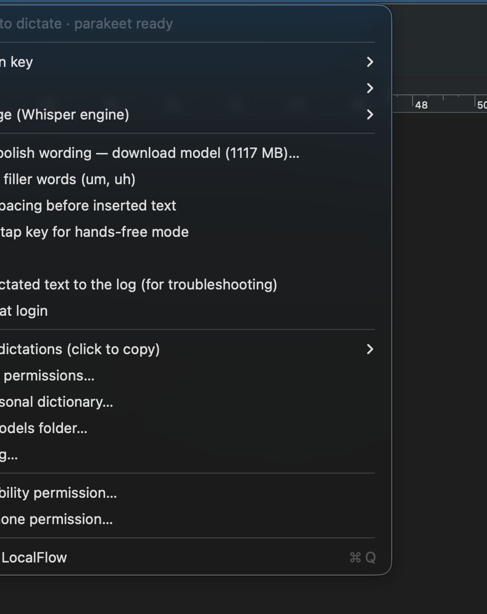

# LocalFlow

Voice typing for macOS that never leaves your Mac. Hold a key, talk, let go: the words appear wherever your cursor is. An offline alternative to Wispr Flow.

<p align="center"></p>

- **Private.** Audio goes from the microphone to a speech model running on your Mac's GPU. No account, no cloud, no network calls. Turn Wi-Fi off and it keeps working.
- **Fast.** The default engine transcribes 8 seconds of speech in under 100 ms on an M-series Mac.
- **Works everywhere.** Any app with a text cursor: Mail, Slack, browsers, editors, terminals.

## Install (no Terminal needed)

1. Download `LocalFlow.zip` from the [latest release](../../releases/latest) and unzip it.
2. Drag **LocalFlow** into Applications and open it. The app is signed and notarized by Apple, so it opens with a double-click.
3. A setup window downloads the speech model (669 MB, one time) and asks for two permissions: Microphone, and Accessibility (so it can see the hotkey and type into other apps).
4. Hold **fn**, talk, release.

Requirements: a Mac with an Apple chip (M1 or newer), macOS 14 or newer, internet once for the model download.

## Features



- Hold fn to dictate; double-tap fn for hands-free mode, tap once to finish. Other keys selectable in the menu.
- Two local engines. **Parakeet** is the default: very fast, and it handles English and 24 European languages (Greek, German, French, Spanish, and more) without you picking one. **Whisper large-v3-turbo** covers about 100 languages for everything Parakeet doesn't, including Chinese, Hindi, Arabic, Japanese, Korean and Turkish.
- Optional **polish wording**: a small local language model (1.1 GB download) that fixes grammar and removes stumbles before typing. Off until you enable it in the menu.
- Filler-word removal, "new line" / "new paragraph" commands, a personal dictionary for names it mishears, smart spacing, clipboard preserved.
- Floating waveform while you speak, menu bar icon, recent dictations in the menu (click to copy), launch at login.

<br clear="right">

## Privacy

Everything stays on the machine. The only network requests the app ever makes are the one-time model downloads from Hugging Face, each verified against a pinned checksum. Recent dictations are kept in a local history file you can clear from the menu. The log never contains dictated text unless you switch that on for troubleshooting.

Files live in `~/Library/Application Support/LocalFlow/` (models, history, dictionary) and `~/Library/Logs/LocalFlow.log`.

## Build from source

Requires Xcode 16+ and Homebrew.

```
brew install whisper.cpp llama.cpp
./build.sh            # builds build/LocalFlow.app with the engine libraries bundled inside
./build.sh install    # also copies it to /Applications and launches it
./build.sh notarize   # signs with a Developer ID certificate, notarizes, staples, zips (needs an Apple Developer account)
```

Engine test without a microphone:

```
.build/release/LocalFlow --transcribe clip.wav parakeet
.build/release/LocalFlow --transcribe clip.wav whisper te
.build/release/LocalFlow --polish "um so I think we should uh move the meeting"
```

Toggle hands-free dictation from scripts, Raycast or Keyboard Maestro: `kill -USR1 $(pgrep -x LocalFlow)`.

## How it works

A CGEvent tap watches the hotkey. AVAudioEngine captures the microphone and resamples to 16 kHz. The audio goes to Parakeet or Whisper through the whisper.cpp libraries, Metal-accelerated. Rule-based cleanup runs, then optionally the Qwen 2.5 rewrite through llama.cpp. The result is placed on the clipboard, pasted with a synthetic Cmd+V into the app you were in when you started talking, and your previous clipboard is restored.

Built with [Claude Code](https://claude.com/claude-code). Third-party components and model licenses: see [THIRD_PARTY.md](THIRD_PARTY.md).

## License

MIT. See [LICENSE](LICENSE).
