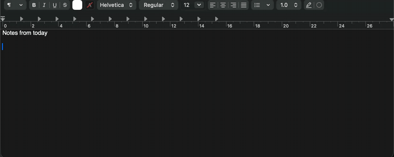
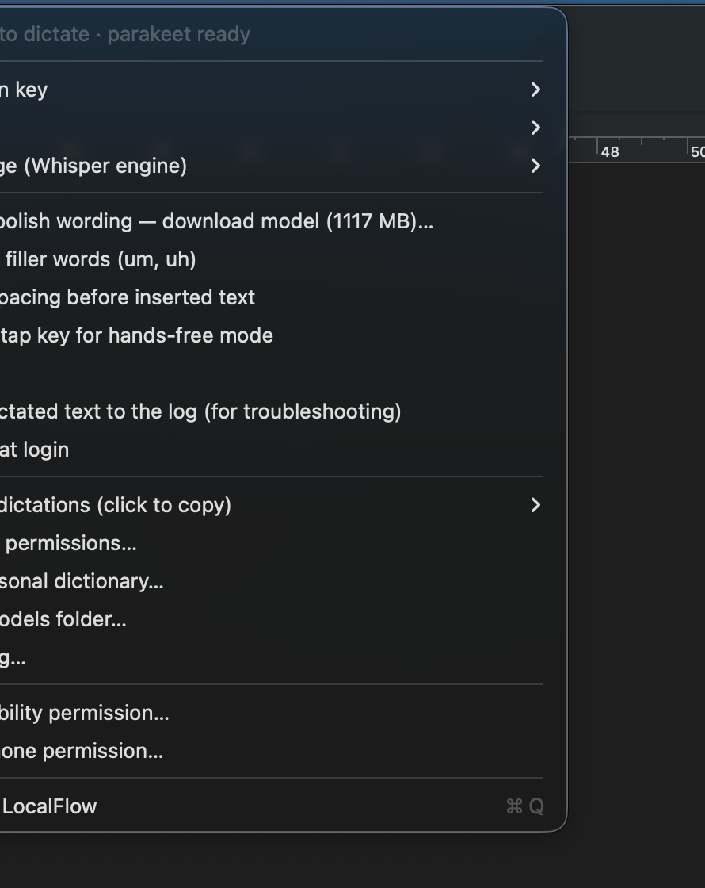

# LocalFlow

[](https://github.com/Bhargavareddy007/LocalFlow/releases/latest)
[](https://github.com/Bhargavareddy007/LocalFlow/releases)
[](LICENSE)


Voice typing for macOS that never leaves your Mac. Hold a key, talk, let go: the words appear wherever your cursor is. An offline alternative to Wispr Flow.

<p align="center"></p>

- **Private.** Audio goes from the microphone to a speech model running on your Mac's GPU. No account, no cloud, no network calls. Turn Wi-Fi off and it keeps working.
- **Fast.** The default engine transcribes 8 seconds of speech in under 100 ms on an M-series Mac.
- **Works everywhere.** Any app with a text cursor: Mail, Slack, browsers, editors, terminals.

## Install (no Terminal needed)

1. Download `LocalFlow.dmg` from the [latest release](../../releases/latest) and open it.
2. Double-click **LocalFlow** in the window that appears. It copies itself into Applications, ejects the disk image and opens from there. (Dragging it onto Applications works too; then open it from Applications.) The app is signed and notarized by Apple.
3. A setup window asks for two permissions: Microphone, and Accessibility (so it can see the hotkey and type into other apps). The speech model is already inside the app, so there's nothing else to download. LocalFlow starts at login unless you untick that box.
4. Hold **fn**, talk, release.

`LocalFlow.zip` on the same page is the same app without the model inside (about 3 MB instead of about 650 MB), handy for updates: it reuses the model you already have, or downloads it (669 MB, one time) on a new Mac.

Requirements: a Mac with an Apple chip (M1 or newer), macOS 26 (Tahoe) or newer.

## Features



- Hold fn to dictate; double-tap fn for hands-free mode, tap once to finish. Other keys selectable in the menu.
- Two local engines. **Parakeet** is the default: very fast, and it handles English and 24 European languages (Greek, German, French, Spanish, and more) without you picking one. **Whisper large-v3-turbo** covers about 100 languages for everything Parakeet doesn't, including Chinese, Hindi, Arabic, Japanese, Korean and Turkish.
- Optional **polish wording**: a small local language model (1.1 GB download) that fixes grammar and removes stumbles before typing. Off until you enable it in the menu.
- Filler-word removal, "new line" / "new paragraph" commands, a personal dictionary for names it mishears, smart spacing, clipboard preserved.
- Floating waveform while you speak, menu bar icon, your last dictation in the menu for 2 minutes (click to copy), launch at login.

<br clear="right">

## Privacy

Everything stays on the machine. Installed from the disk image, the app makes no network requests at all unless you turn on Whisper or polish wording. The only network requests it can make are the one-time model downloads from Hugging Face (huggingface.co, which redirects to its CDN on a *.hf.co host), pinned to an exact file version and verified against a pinned checksum. The app only ever loads those three files and checks each one's checksum every time it loads it: the speech models load from the very bytes that were checked, and the optional polish model from a private copy of the file that was checked, which later changes to the file can't reach. Polished text is typed only if it adds no control characters or line breaks. To type into other apps, LocalFlow briefly puts the text on the clipboard and then puts your previous clipboard back; the text is marked local-only and private, so Universal Clipboard and clipboard managers skip it. It never types into password fields. No history is kept: only your last dictation stays in memory for 2 minutes, so you can copy it again from the menu if a paste didn't land, and nothing is written to disk. Text left on the clipboard instead of pasted (because focus moved, or copied from the menu) is cleared after the same 2 minutes, unless you've copied something else since. The log never contains dictated text unless you switch that on for troubleshooting, in the menu: the menu bar icon turns orange while it's on, it turns itself off when the app quits, and it wipes the log when turned off.

Files live in `~/Library/Application Support/LocalFlow/` (models, personal dictionary) and `~/Library/Logs/LocalFlow.log`.

## Build from source

Requires Xcode 16+ and Homebrew.

```
brew install whisper.cpp llama.cpp
./build.sh            # builds build/LocalFlow.app with the engine libraries bundled inside
./build.sh install    # also copies it to /Applications and launches it
./build.sh notarize   # signs with a Developer ID certificate, notarizes, staples, zips (needs an Apple Developer account)
```

Engine test without a microphone:

```
"build/LocalFlow.app/Contents/MacOS/LocalFlow" --transcribe clip.wav parakeet
"build/LocalFlow.app/Contents/MacOS/LocalFlow" --transcribe clip.wav whisper te
"build/LocalFlow.app/Contents/MacOS/LocalFlow" --polish "um so I think we should uh move the meeting"
```

Debug builds (`swift build`) also honour two troubleshooting preferences that release builds ignore: `saveRecordings` (keeps the last 30 recordings as WAV files) and `signalToggle` (`kill -USR1` toggles hands-free dictation).

## How it works

A CGEvent tap watches the hotkey. AVAudioEngine captures the microphone and resamples to 16 kHz. The audio goes to Parakeet or Whisper through the whisper.cpp libraries, Metal-accelerated. Rule-based cleanup runs, then optionally the Qwen 2.5 rewrite through llama.cpp. The result is placed on the clipboard, pasted with a synthetic Cmd+V into the app you were in when you started talking, and your previous clipboard is restored.

Built with [Claude Code](https://claude.com/claude-code). Third-party components and model licenses: see [THIRD_PARTY.md](THIRD_PARTY.md).

## License

MIT. See [LICENSE](LICENSE).
